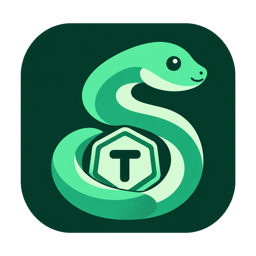
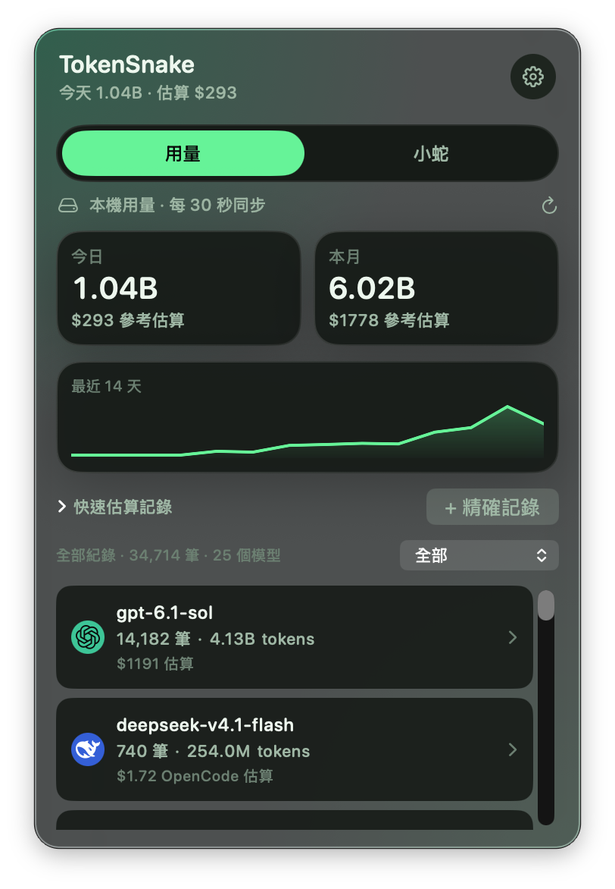
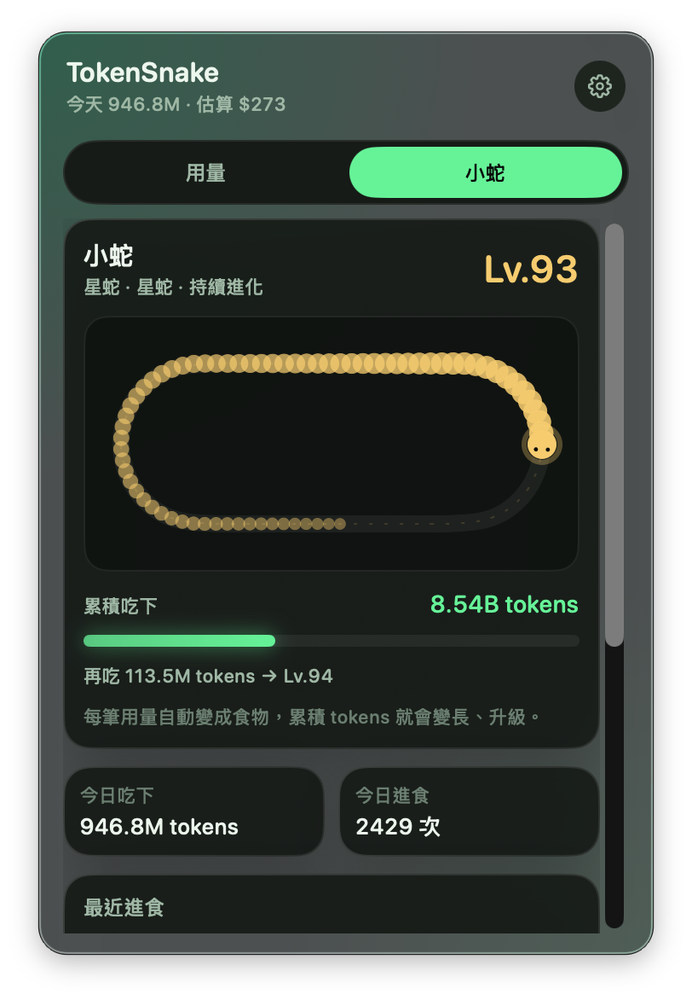

<p align="center">
  
</p>

<h1 align="center">TokenSnake</h1>

<p align="center">在 macOS 選單列追蹤 AI 用量，讓每一筆 tokens 餵養小蛇。</p>

<p align="center">
  <a href="https://github.com/irons163/TokenSnake/releases/latest">下載最新版</a> ·
  <a href="SECURITY.md">隱私與安全</a>
</p>

macOS 選單列上的 AI 用量儀表板，以 SwiftUI 製作。自動讀取本機 Codex、Claude Code 與 OpenCode 用量，並可選擇連線 Cursor 讀取雲端用量，讓真實使用的 tokens 餵養小蛇、累積成長，也可手動管理訂閱月費。

## 畫面

| 用量總覽 | 小蛇成長 |
| :---: | :---: |
|  |  |

## 安裝

需要 **macOS 14 或更新版本**，支援 Apple Silicon 與 Intel。直接安裝 Release 版本即可使用。

1. 前往 [下載最新版](https://github.com/irons163/TokenSnake/releases/latest)，依 Mac 晶片選擇 DMG：

   | Mac 晶片 | 下載檔案 |
   | --- | --- |
   | Apple Silicon（M 系列） | `TokenSnake-<版本>-apple-silicon.dmg` |
   | Intel | `TokenSnake-<版本>-intel.dmg` |

2. 開啟 DMG，將 `TokenSnake.app` 拖進 **Applications**。
3. 開啟 App，點選選單列的小蛇即可查看用量。App 不會出現在 Dock。
4. 若紀錄位於外接磁碟或受保護目錄，依 macOS 提示允許讀取，或到齒輪設定選擇紀錄目錄。

正式 Release 已使用 Developer ID 簽章並通過 Apple 公證。安裝後可從齒輪設定的「App 更新」檢查新版；預設每小時自動檢查，不自動下載。

## 功能

- **選單列**：與 App icon 一致的 S 形小蛇及 T token，使用 18pt 單色圖示適應深淺色背景。可選擇顯示小蛇等級、今日 tokens、今日／本月花費或最近續費。
- **用量**：啟動後掃描歷史紀錄，之後每 30 秒增量更新。顯示今日、本月、最近 14 天與來源篩選；清單依模型分組，彙總全部紀錄的筆數、tokens 與估算費用，點擊可展開單筆明細。可精確輸入 tokens，或用快速估算按鈕手動記錄。
- **小蛇**：每筆用量自動進食，累積 tokens 決定等級與身長。顯示升級進度、今日進食、最近食物與 13 週用量熱圖；新用量出現時播放吃食物的動畫。休息會保留成長，預算及模型費率不影響餵養。
- **設定**：選擇來源、變更紀錄目錄、立即同步、重新匯入、預算、選單列顯示、登入時啟動，以及 JSON 備份匯出／還原。「訂閱管理」預設收合，可選填月費與續費日，保留範本、自訂帳號、編輯與手動額度管理。進入新月度週期後會重設已用額度；範本請依實際帳單調整。

主介面分為「用量／小蛇」，訂閱資料在齒輪設定的「訂閱管理」。

## 自動餵養與成長

所有已記錄的有效用量都會計入累積食物，包含歷史匯入與手動用量；每筆食物是輸入加輸出 tokens，輸入中的快取不會額外重複計入。重複同步、重啟及重新匯入會沿用去重紀錄，不會再餵一次。未來日期的紀錄要到當天才計入。

Lv.1 從蛇蛋開始，第一筆用量即可孵化。升級門檻為 `1,000,000 × (等級 − 1)²`：Lv.2 為 1M、Lv.3 為 4M、Lv.4 為 9M tokens；隨等級增加身長，並經歷幼蛇、長蛇、靈蛇與星蛇階段。畫面直接顯示距下級所需的 tokens。

成長直接由用量紀錄計算，不依賴打卡、習慣完成數、價格或預算。沒有使用的日子只會休息；刪除／隱藏用量或還原備份時，成長會跟著有效紀錄修正。舊版習慣資料會保留在備份中，但不再控制餵養。

## 自動同步

支援 **Codex、Claude Code、OpenCode** 的本機用量，以及 **Cursor** 的雲端用量。

- 本機來源在啟動時自動匯入歷史紀錄，之後每 30 秒更新。
- 可在齒輪設定選擇來源、變更紀錄目錄，或按「立即同步」。若 macOS 顯示磁碟存取提示，請允許讀取紀錄位置。
- Cursor 預設關閉；先登入 Cursor，再於 TokenSnake 設定啟用並確認連線，即可同步雲端用量。

## 費用

Codex、Claude Code 依內建 API 費率估算；OpenCode 優先採用來源提供的估算；Cursor 使用來源回傳的帳單費用。API 估算不等同訂閱費或實際扣款，價目表隨 App 版本更新。

「費率未收錄」代表目前缺少可用的計價資料，不代表免費；tokens 仍會完整統計。選單列金額後的 `+` 表示總額尚不完整。

## 資料與備份

資料位於 `~/Library/Application Support/TokenSnake/store.json`，舊版資料會自動讀取。退出 App 時會立即保存。寫入失敗會在介面提示；無法讀取的資料會先保留 `.corrupt-*.json` 副本。備份還原前，原檔會保留為 `.backup-*.json`。

設定中可匯出 JSON 備份，再用「還原資料備份」恢復。清除或載入示範資料前，建議先匯出。

App 對啟動資料與還原備份使用相同驗證，拒絕異常 tokens、快取、額度與同步游標。單個快照讀取上限為 256 MiB；資料及備份使用僅擁有者可讀寫的權限。備份內含目錄路徑及用量資訊，請保留在私人位置。公開範圍與回報方式見 [SECURITY.md](SECURITY.md)。

## 從原始碼建置

開發環境需求：

- macOS 14 或更新版本
- Xcode 26 或更新版本（Swift 6 與明確的並行隔離）
- [XcodeGen](https://github.com/yonaskolb/XcodeGen)

```bash
brew install xcodegen
xcodegen generate
xcodebuild test -project TokenSnake.xcodeproj -scheme TokenSnake \
  -destination 'platform=macOS' CODE_SIGNING_ALLOWED=NO
```

產出 Apple Silicon／Intel 通用本機版 App 與 ZIP：

```bash
./Scripts/build-release.sh
open build/TokenSnake.app
```

產物使用 ad-hoc 簽章，供本機使用；對外散布時需自行使用 Developer ID 簽章與 notarization。
